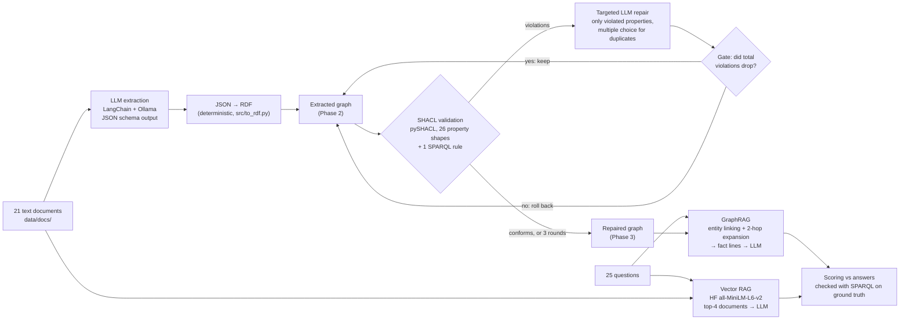

# Verified GraphRAG for Manufacturing Text

A small, local, fully logged research prototype:

1. A local LLM **extracts a knowledge graph** (RDF) from short, unstructured manufacturing documents.
2. The graph is **verified with SHACL** (pySHACL), and the violations go back to the LLM for **repair**. This is the
   generate, validate, repair loop from my MSc thesis, applied here to extracted knowledge instead of simulation models.
3. Questions are answered with **GraphRAG** over the graph and compared with **plain vector RAG** over the raw text.

Everything runs on a CPU-only laptop with no paid APIs. Every number in this README comes from a file in `results/`.

### Headline results (honest version)

- **Extraction:** after fixing two pipeline bugs, triple-level F1 was **0.742** (precision 0.613, recall 0.939) against a 179-triple ground truth.
- **SHACL repair:** naive "rewrite the entity" repair made the graph *worse* (F1 0.742 → 0.658, violations 54 → 71).
  **Targeted, multiple-choice, gated** repair helped a little: F1 0.742 → **0.767**, violations 54 → **21**. But the gate
  also accepted some invented values, so fewer violations did not always mean more true facts.
- **QA:** on the graph this pipeline built, GraphRAG did **not** beat vector RAG (lenient accuracy 0.4 vs 0.52). On the
  hand-written ground-truth graph, GraphRAG scored best (0.64). Extraction quality is the bottleneck.
  With 25 questions, none of these differences is statistically significant (sign-test p ≥ 0.453).

## Pipeline



## Tools

| Tool | What it is (in 3 lines) | Used for |
|---|---|---|
| **Ollama** | A local server that downloads open LLMs and runs them on your own machine. You call it over HTTP on `localhost:11434`. It can constrain the output to a JSON schema. | Runs `qwen2.5:3b-instruct` on CPU with temperature 0, seed 42, and `keep_alive=0`. |
| **LangChain** | A Python library that puts different LLMs behind one interface. You chain prompt templates, models and output parsers (`prompt \| llm`). `with_structured_output` turns a Pydantic class into a JSON schema and parses the reply. | All prompts, structured extraction/repair/QA output, the vector store and retriever. |
| **Hugging Face** | A hub of open models plus the libraries to run them. `sentence-transformers` turns a sentence into a vector, so that similar meanings get nearby vectors. | `all-MiniLM-L6-v2` embeddings (384 dimensions) for the vector-RAG baseline, via `langchain-huggingface`. |
| RDFLib / pySHACL | RDF graphs and SPARQL in Python / SHACL validation. | The knowledge graph, shapes, scoring, answer verification. |

Hardware: Intel i5-8250U (4 cores), 7.9 GB RAM, no discrete GPU. That is why a 3B model was used rather than a 7B/8B one.

## Data (all synthetic, written for this project)

- `data/docs/`: 21 short documents about a fictional 6-machine line (presses P1/P2, washer W1, assembly cell A1,
  inspection I1, packer K1, buffers B1–B5). They are: a line overview, 6 data sheets, a buffer layout, a shift plan,
  8 maintenance reports, 2 shift notes, an energy audit, and a safety walk with no line facts (a distractor). The documents contain deliberate traps:
  MTTR given in minutes, a "45 kW (includes 30 kW heater)" rating, mixed date formats, and incidents mentioned in passing.
- `data/ground_truth.ttl`: the 179 triples these documents state, written by hand. It conforms to all shapes.
- `data/questions.json`: 25 questions (10 one-hop, 8 multi-hop, 7 aggregation). Each one has a SPARQL query that
  reproduces its answer from the ground truth (`tests/test_questions.py`).
- `schema/ontology.ttl` (6 classes) and `schema/shapes.ttl` (SHACL: types, ranges such as `powerKW > 0`, cardinality,
  `mttr < mtbf`, and a SPARQL topology rule: every machine except the line's last one must feed a buffer).

## How to run

Setup (Windows; Ollama and models live on `F:\Tools`, everything else in this folder):

```bash
ollama pull qwen2.5:3b-instruct
python -m venv .venv
.venv\Scripts\python -m pip install torch --index-url https://download.pytorch.org/whl/cpu
.venv\Scripts\python -m pip install -r requirements.txt
```

Pipeline. LLM steps take minutes to hours on a CPU; total LLM time in this project was 7.46 h:

```bash
.venv\Scripts\python -m pytest tests -v          # 106 tests, no LLM needed (results/pytest_final.txt)
.venv\Scripts\python -m src.hello                # Phase 0: LangChain -> Ollama smoke test
.venv\Scripts\python -m src.phase1_schema        # Phase 1: ontology/shape statistics
.venv\Scripts\python -m src.extract              # Phase 2: extraction + P/R/F1
.venv\Scripts\python -m src.repair_v2            # Phase 3: targeted + gated repair (src.repair = v1 baseline)
.venv\Scripts\python -m src.phase4_eval          # Phase 4: 4 QA conditions x 25 questions
.venv\Scripts\python -m src.report               # Phase 5: rebuild results/summary.md from results/
```

## Results

All tables below are copied from `results/summary.md`, which `src/report.py` generates from the result files.

### Phase 1: schema

| Classes | Object properties | Datatype properties | Node shapes | Property shapes | Constraints |
|---|---|---|---|---|---|
| 6 | 6 | 12 | 7 | 26 | 86 |

Each of the 27 shapes (26 property shapes + 1 SPARQL rule) has a test that breaks a valid graph on purpose and checks
that this shape reports the expected kind of violation. A meta-test fails if a shape has no such test. To check that the tests themselves can fail,
I deleted two rules on purpose and confirmed their tests failed.

### Phase 2: extraction

| Extraction run | Precision | Recall | F1 | Correct | Extracted | Gold | Source |
|---|---|---|---|---|---|---|---|
| v1: optional JSON fields | 0.651 | 0.313 | 0.423 | 56 | 86 | 179 | `results/phase2_v1_scores.json` |
| v2: all fields required, output cap | 0.613 | 0.939 | 0.742 | 168 | 274 | 179 | `results/phase2_scores.json` |

v1 exposed two bugs. With optional fields, constrained decoding let the model skip whole sections (0 failures extracted),
and with no output cap one document looped for 2.3 hours. v2 fixes only those bugs.
Typical remaining errors: invented entities from the distractor documents, duplicate entities under two names (`line_A` and
`line_LINEA`), several competing values for one property, and units not converted (`mttrH 45`).

### Phase 3: SHACL verify and repair

**v1, the whole entity rewritten by the LLM** (`results/phase3_v1_repair.json`):

| Round | Violations | Entities w/ violations | Triples | Precision | Recall | F1 |
|---|---|---|---|---|---|---|
| 0 | 54 | 26 | 274 | 0.613 | 0.939 | 0.742 |
| 1 | 76 | 16 | 226 | 0.588 | 0.743 | 0.657 |
| 2 | 37 | 15 | 218 | 0.647 | 0.788 | 0.71 |
| 3 | 71 | 13 | 225 | 0.591 | 0.743 | 0.658 |

**v2, targeted + multiple choice + gated** (`results/phase3_v2_repair.json`). Only properties named in a violation are
editable (a JSON schema is built per call). If a property has too many values, the model must choose one of them (an enum).
A change is kept only if the total number of violations drops:

| Round | Accepted repairs | Violations | Entities w/ violations | Triples | Precision | Recall | F1 |
|---|---|---|---|---|---|---|---|
| 0 | - | 54 | 26 | 274 | 0.613 | 0.939 | 0.742 |
| 1 | 17 | 24 | 12 | 254 | 0.65 | 0.922 | 0.762 |
| 2 | 1 | 21 | 11 | 251 | 0.657 | 0.922 | 0.767 |
| 3 | 0 | 21 | 11 | 251 | 0.657 | 0.922 | 0.767 |

49 attempts, 18 accepted, 31 rolled back by the gate. Per-predicate F1 changes (all others unchanged):

| Predicate | F1 before repair | F1 after v2 repair | Gold triples |
|---|---|---|---|
| feeds | 0.769 | 0.952 | 10 |
| label | 0.545 | 0.649 | 15 |
| type | 0.785 | 0.795 | 31 |
| date | 0.7 | 0.683 | 16 |
| finalMachine | 0.2 | 0.0 | 1 |

### Phase 4: GraphRAG vs vector RAG

Exact = the bare value or name equals the answer. Lenient = numbers within 2 %, or the expected code appears in the answer.

| Condition | Exact | Lenient | 1-hop (10) exact / lenient | Multi-hop (8) | Aggregation (7) |
|---|---|---|---|---|---|
| Vector RAG (raw documents) | 0.48 | 0.52 | 0.7 / 0.8 | 0.5 / 0.5 | 0.143 / 0.143 |
| GraphRAG, unrepaired graph | 0.2 | 0.36 | 0.4 / 0.6 | 0.125 / 0.375 | 0.0 / 0.0 |
| GraphRAG, repaired graph (v2) | 0.2 | 0.4 | 0.3 / 0.6 | 0.25 / 0.5 | 0.0 / 0.0 |
| GraphRAG, ground-truth graph (upper bound) | 0.4 | 0.64 | 0.6 / 1.0 | 0.375 / 0.625 | 0.143 / 0.143 |

| A vs B (lenient) | Both right | Only A | Only B | Both wrong | Sign test p |
|---|---|---|---|---|---|
| Vector RAG (raw documents) vs GraphRAG, repaired graph (v2) | 6 | 7 | 4 | 8 | 0.549 |
| GraphRAG, unrepaired graph vs GraphRAG, repaired graph (v2) | 9 | 0 | 1 | 15 | 1.0 |
| Vector RAG (raw documents) vs GraphRAG, ground-truth graph (upper bound) | 11 | 2 | 5 | 7 | 0.453 |

Vector retrieval found every needed document for 16 of 25 questions (`results/phase4_scores.json`).

### Run history: what failed and what changed

Each "v1" stays in `results/` with a `_v1_` name. Each v2 changed only what is listed here, and every fix round was limited to one.

| Step | v1 problem (evidence) | v2 change |
|---|---|---|
| Phase 0 | With the model kept loaded, the same prompt sometimes gave a different answer (`phase0_cache_nondeterminism_log.jsonl`) | `keep_alive=0`: reload the model for every call (3/3 identical in `phase0_hello.json`) |
| Phase 2 | Optional JSON fields were skipped; one 2.3-hour output loop | All fields required (null allowed); 1500-token cap; no real codes in prompt examples |
| Phase 3 | Rewriting whole entities corrupted unrelated facts (`"bytes"` instead of `90.0`) | Targeted, multiple choice, gated |
| Phase 4 | The model never saw the JSON format; answer came before evidence, so answers were garbled | Format written in the prompt; evidence first |

## What worked

- **SHACL as an error detector.** It found real extraction errors: duplicate labels, competing start hours, broken
  topology, and invented entities with missing fields. Testing each shape for failure made the shapes trustworthy.
- **Multiple choice beats free generation for repair.** When the 3B model only had to *choose* among existing values,
  it was reliable: all 6 machines got their correct full name, and `feeds` F1 rose from 0.769 to 0.952.
- **The gate prevented the v1 failure mode.** No correct fact was corrupted by an unrelated rewrite. Harmful deletions were rolled back
  (this is unit-tested with a fake LLM).
- **A clean graph supports GraphRAG.** With the ground-truth graph, GraphRAG answered every one-hop question correctly (lenient 1.0).
- **Engineering lessons worth keeping:** constrained decoding needs the format in the prompt as well; optional schema
  fields get skipped; a local server's cache can break reproducibility.

## Limitations (please read before citing any number)

- **Synthetic, self-written data.** I wrote the documents, the ground truth and the questions, so they share my
  assumptions. Real maintenance logs are messier.
- **Small sample.** 21 documents, 179 triples, 25 questions. One question = 0.04 accuracy, and no QA difference here is statistically
  significant.
- **One small model, one run.** `qwen2.5:3b-instruct` on CPU, temperature 0, one seed. Results may change with other
  models, seeds or prompt wording. Variance across these was not measured.
- **Designs were revised after seeing v1 results** (one round each, disclosed above). The v2 designs were therefore informed by
  failures on this same test data, so they may be somewhat tuned to it.
- **SHACL checks form, not truth.** Errors that break no rule (wrong but well-formed values, duplicate entities with
  different IRIs) are invisible. The gate even accepted invented values that filled a missing-value violation.
- **Simplifications.** Entity identity comes from the codes written in the text (`P2`, `INC-204`), not from real
  entity resolution. Entity linking in GraphRAG is rule-based. Triple scoring is strict string matching (for example,
  "Hydraulic leak at the main cylinder seal" does not match "Hydraulic leak").
- **Aggregation was left to the LLM**, which cannot count or sum reliably at 3B. Some answers are still degenerate (`"sync"`).

## Three next steps

1. **Grounded repair.** Accept a generated repair value only if it appears in the source text (span check), in addition to the SHACL gate.
   This targets the main v2 weakness: the gate accepting invented values.
2. **Text-to-SPARQL for aggregation.** Let the LLM write a SPARQL query over the verified graph, validated against the ontology,
   and let RDFLib do the counting and summing. Seven of the 25 questions are aggregations, and every method scored at most 0.143 on them.
3. **Scale the evaluation and add entity resolution.** Use real or semi-real logs, more questions, a 7–8B model on a GPU and
   several seeds, so differences can become significant. Add SHACL-SPARQL rules that detect likely duplicate entities (`line_A` and `line_LINEA`).

## Reproducibility and traceability

- temperature 0, seed 42, and a model reload per call (`src/llm.py`); all prompts in `prompts/`
- every LLM call (354 in total) logged with input, output and time in `results/llm_log.jsonl` (usage in `results/llm_usage.json`)
- `tests/test_readme_numbers.py` fails if a number in a README table does not appear in a results JSON file

## Repo layout

```
src/        code: config, llm (only LLM entry point), validate, extract, to_rdf, score,
            repair (v1), repair_v2, vector_rag, graph_rag, qa, phase4_eval, report
prompts/    every prompt as a .txt file
schema/     ontology.ttl, shapes.ttl
data/       docs/, ground_truth.ttl, questions.json
tests/      106 pytest tests (no LLM needed)
results/    every number, every graph version, every LLM response
```
